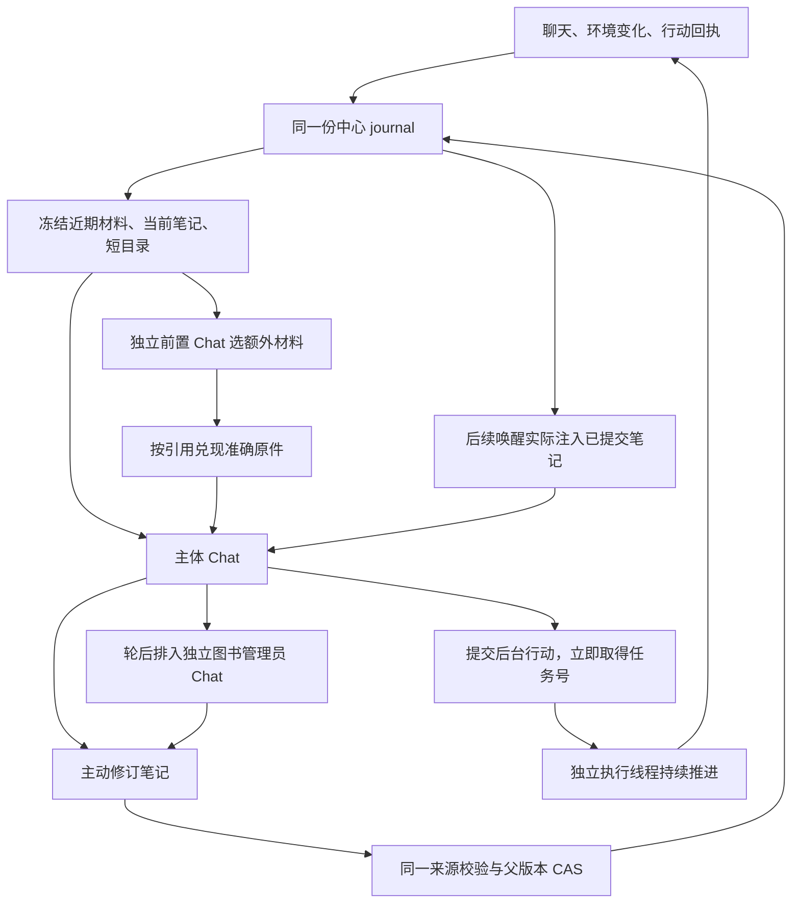

# 前置选材、轮后整理与持续行动

2026-10-22。[T26](tickets/T26-接通前置选材轮后整理与持续行动的隔离闭环.md)的隔离交付记录。目标仍是让柚子积累经验并自己选择关注和行动；本轮补上此前自由实验缺失的两个辅助角色，以及不依赖模型逐步驱动的后台行动。默认 live 路由没有切换。

## 实际运行方式

主入口是 [Center](../../../mods/chat/center.py) 的显式 `isolated(center)`。只有传入 `selector_model`、`librarian_model` 才开启对应角色；本轮 runner 显式开启两者。前置不能删近期材料或当前笔记，可以读冻结原件，再提交额外 key；它的解释文本不会直接变成主体经历。主体仍可 `read_archive`、`read_past` 和主动 `commit_note`。

[cognition.py](../../../mods/chat/cognition.py) 使用独立 Chat 和角色上下文，复用同一客户端、请求观察和共同费用守卫。主体本轮结束后，图书管理员接收实际已曝光材料及已提交输出／结果的冻结副本，后台整理；主体可以先继续下一醒，不必等候选完成。辅助输出不会确认主唤醒。

笔记版本、来源和提交记录仍在唯一 journal。主循环和图书管理员共用 `commit_note`：只接受实际请求见过的父版本和来源；陈旧候选拒绝覆盖，不把目录、嵌套提及或模型生成文字自动提升为原件来源。恢复不自动重放后台模型任务。

真实失败后，给三个角色的每次请求加入精确 `allowed_source_ids` 和 `frozen_parent`。只能逐字引用裸 ID；缺少原件时，主循环先读原件，在后续请求确认曝光后提交。拒绝反馈返回原请求的范围，不返回后来新 head，不自动改写模型给出的来源串。最新一张范围表才代表当前请求。

[Actions](../../../mods/chat/actions.py) 的一个后台线程接收 step 序列，工具先返回 accepted／任务号。`append` 保留队尾；`replace` 保留当前任务并撤掉等待项；`now` 请求取消当前任务，再把新任务插到原等待队列前。停止是协作请求，真实终态由执行回执确认。恢复将未收束执行标 unknown、等待项标 cancelled，不重放副作用。进度和终态写回同一 journal；新的环境事实在主体下次模型请求前注入。

这使持续执行不必等模型响应；局部反射可以先停止行动，再把原因交给主体决定。当前没有对在途模型 HTTP 的抢占；安装退出会等待有限请求和合作的执行线程收束。故障清理只取消和 join 本地工作，不伪造持久终态，也不掩盖已有中心故障。

## 实验与反例

外部证据根为 `/root/work/agent-memory-complete-loop-20261022/`，只含合成材料。角色分工验证使用实际 Chat／SDK 加 MockTransport；联合房间使用 [continuous_room.py](../../../experiments/continuous_room.py)，没有 OneBot 真出口、宿主控制或生产材料。场景给定一个搬空盒任务，检验接线；不是自由选择目标的实验。

- 无模型联合验证：19 次 SDK 请求与 journal payload 一致；三个角色、整理后实际消费、行动推进、主路封闭后改走侧路、线程退出均有证据。费用 0。`mock-room-1.log` 保留最初合成群未登记与异常清理失败；修复后证据为 `mock-room-2/checks.json`。另有角色 CAS／关闭交界和行动队列、取消、恢复零重放的定向证据。
- 真实段一：30 次供应商成功请求，154,538 tokens，按保守单价估算 0.334672 元；额外预提交请求在出网前被守卫拒绝，不能算第 31 次收费。前置选取原件进入主体；图书管理员创建 C152，后续成功主体请求 C181 读到完整版本。行动只到位置 1。房间没有说明两端和合法参数，模型猜错目的地，重复提交当前位置；原失败保留于 `official-room-1/`。
- 真实段二：29 次成功，172,263 tokens，保守估算 0.388278 元。动作抵达位置 10；有三个主体 HTTP 等待区间发生实际位移。六次笔记提交全部被来源校验拒绝，**没有 note**，`followup_saw_note=false`；不能宣称此段有图书管理员写回后的消费。模型把裸 ID 写成带说明的字符串，或引用本醒只间接提及的旧结果。记录于 `official-room-2/` 与 `evidence-trial-2.json`。
- 真实段三：来源接口修正后，21 次成功，132,251 tokens，保守估算 0.288994 元，31.74 秒结束。selector／main／librarian 各 5／8／8 请求。图书管理员依次提交 C79、C108、C153；成功主体请求 C90 完整消费 C79，后续追问请求 C136 完整消费 C108。C153 尚未被后续主体消费。主体回答钥匙是旧便条信息、未经核实，并报告盒子已到位置 10。侧路行动在三个主体 HTTP 区间推进，主路封闭没有误停侧路；本段未验证主路取消。全部 21 个请求的最新引用范围表与实际 request.sources／note 一致。证据为 `official-room-3/`、`evidence-trial-3.json`。

第二段还有明确的语义反例：候选把初始开放状态写成封闭，把 `now` 写成清空等待队列，把 bot 的 say 回执写成用户确认。这些文字没有成功成为笔记；即使来源成员校验通过，也不能据此证明正文准确。场景本身也错误地在主路关闭时取消了已走侧路的任务，随后已修为只停止主路。首次口头把第二段说成笔记消费成功已纠正，以 journal 和独立核验为准。

第三段则有**已接受**的错误：C153 把回答的动作引用记成 C146#1；实际回答为 C138#1，C146 是图书管理员的 read_note 输出。来源成员校验允许提交，不能核实文字里每个编号的归属。此错误保留，不把“成功保存”解释为记忆准确。

三段合计 80 次供应商成功请求、459,052 tokens，应用保守估算 **1.011944 元**，没有新增未知请求费用预留；原共同账历史未知额度仍保留。估算使用已有官方价目研究的保守费率，不代表供应商账单核验。每段另限 30 次请求、750,000 tokens、应用估算 3 元，实际全部低于 token／费用子上限；第一段用尽请求数即停。凭据只经隐藏 stdin 进入本地进程，没有迁往 4 号机；4 号机 SSH 本轮超时，本地只做有限轻量运行。

最终源代码集成到 `6896bf7`。`run.py --check` 通过（131 Python 文件／85 模块）；fake smoke 83／85，仅原有 mcf／minecraft 可选失败，与改前一致。角色引用反馈、陈旧候选、动作故障清理、队列顺序和恢复不重放使用外部定向脚本，没有新增永久测试套件。实现 worktree 清理后保留 `codex/accepted/t26-*` 引用与外部证据。

## 当前边界

这是有限历史、合成窗口的实际隔离闭环。journal 恢复和候选目录仍随历史增长；近期条目数与最终请求上界不等于长期资源已解决。当前 recent_count 取全局材料尾部，本轮单窗口证据不能证明多窗口各自近期画面的保证。多窗口分配、长期召回、笔记语义可靠性、真正长期主体性、Minecraft 等真实行动适配仍需具体实验；本轮不借此引入检索框架或记忆引擎。

真实材料迁移、生产开关、重启、QQ 出口及旧机制退役仍沿原授权边界。D12／D13／D14 的未完成结论不因 T26 的隔离代码交付而自动通过。研究票也不成为以后普通代码或行为更新的通用前置。
